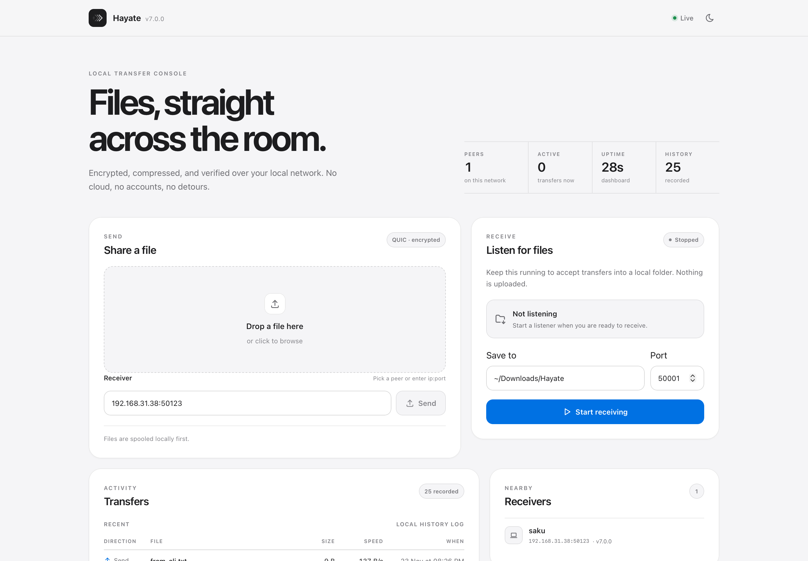

<div align="center">


# Hayate

**Encrypted, compressed LAN file transfer — one binary, no cloud, no accounts, no SSH.**

QUIC transport · X25519 + Argon2id + AEAD · 4-word pairing phrases · local web dashboard

[](https://hayate.shiina.xyz)
[](https://github.com/ShiinaSaku/Hayate/actions/workflows/ci.yml)
[](https://crates.io/crates/hayate)
[](https://npmx.dev/package/@shiinasaku/hayate)
[](https://docs.rs/hayate)
[](Cargo.toml)
[](LICENSE)

**English** · [日本語](./README.ja.md)

</div>

```console
$ hayate send ./photos.zip

   ●  Pairing code
   forest-river-mango-silver-orbit

   Receiver runs:  hayate receive --code "forest-river-mango-silver-orbit"
```

One command on each machine. Files move encrypted, compressed, and verified — directly
over the local network.

<div align="center">

<br />
<sub><code>hayate web</code> — token-gated, loopback-only dashboard with live peers and history.</sub>
</div>

## Contents

- [Why Hayate](#why-hayate)
- [Features](#features)
- [Installation](#installation)
- [Quick start](#quick-start)
- [Command reference](#command-reference)
- [Web dashboard](#web-dashboard)
- [Scripting and automation](#scripting-and-automation)
- [How it works](#how-it-works)
- [Security model](#security-model)
- [Performance](#performance)
- [Comparison](#comparison)
- [Library usage](#library-usage)
- [Development](#development)
- [Release](#release)

---

## Why Hayate

- **No infrastructure.** No relay, no rendezvous server, no SSH daemon. Two devices on the same
  network are enough.
- **Authenticated by a phrase.** A 4-word code (≈41 bits) is stretched with memory-hard
  Argon2id and mixed into the key exchange, so only the peer that knows it can derive the
  session key.
- **Fast where it counts.** QUIC with 4 MiB frames, asynchronous read-ahead, and zstd + AEAD on
  dedicated worker threads.
- **Resumable and verifiable.** Interrupted files continue from the last frame boundary; checksums
  cover the whole file, including the already-received prefix.
- **Inspectable.** A local dashboard shows peers and history without sending anything anywhere.

## Features

| | |
| --- | --- |
| **Transport** | QUIC (compio: io_uring / IOCP / kqueue), 4 MiB frames, 8-deep read-ahead, 48 MB flow windows |
| **Encryption** | Ephemeral X25519 ECDH, Argon2id phrase stretch, HKDF-SHA256, per-frame AES-256-GCM or ChaCha20-Poly1305 |
| **Pairing** | 4-word phrases, mDNS + UDP discovery, direct `ip:port`, optional `--passphrase` |
| **Integrity** | BLAKE3 (default) or SHA-256 over plaintext; size and frame validation on receive |
| **Resume** | Single-file transfers continue from the last 4 MiB boundary; complete files are re-verified |
| **Compression** | zstd level 1, skipped for compressed formats and disabled adaptively for incompressible data |
| **Control** | `--bandwidth-limit`, named peers, interactive picker (`send --pick`), overwrite policy |
| **Dashboard** | `hayate web`: drag-and-drop send, built-in receive listener, live progress, history, token auth |
| **Scriptability** | NDJSON events (`schema: hayate/1`), stable exit codes, `--quiet` / `--verbose` |
| **Platforms** | macOS, Linux, Windows — one static binary each (Android/Termux builds from source) |

Under the hood Hayate runs on [compio](https://github.com/compio-rs/compio), a completion-based
async runtime built on the same kernel primitives as modern high-throughput servers.

---

## Installation

### Shell installer

```bash
curl --proto '=https' --tlsv1.2 -LsSf \
  https://github.com/ShiinaSaku/Hayate/releases/latest/download/hayate-cli-installer.sh | sh
```

Windows PowerShell: run `hayate-cli-installer.ps1` from the
[latest release](https://github.com/ShiinaSaku/Hayate/releases).

### npm

```bash
npm install -g @shiinasaku/hayate
# or run it without installing:
npx @shiinasaku/hayate --help
```

The package downloads the matching prebuilt binary (macOS, Linux, Windows; x64 or arm64) at
install time.

### GitHub Releases

Prebuilt archives (`.tar.xz` / `.zip`), installers, `sha256.sum`, and build-provenance
attestations: [latest release](https://github.com/ShiinaSaku/Hayate/releases).

### From source

```bash
git clone https://github.com/ShiinaSaku/Hayate.git
cd Hayate
mise run build          # or: cargo build --release -p hayate-cli
./target/release/hayate --help
```

Requires **Rust 1.96** (edition 2024). The dashboard bundle is committed, so no JavaScript
toolchain is needed to build the CLI.

### Library

```bash
cargo add hayate
```

The transfer engine ships as a [library crate](https://docs.rs/hayate) — build your own
interface on top of it.

---

## Quick start

### Pairing mode — no IP addresses

```bash
# Sender: prints a one-time phrase and waits
hayate send ./photos.zip

# Receiver: joins with the same phrase
hayate receive --code "forest-river-mango-silver-orbit"
```

A wrong phrase fails AEAD authentication and the transfer aborts.

### Direct mode — you know the address

```bash
hayate receive --port 50001 --output ./downloads
hayate send ./archive.tar.gz 192.168.1.50:50001
```

Pass `--passphrase <secret>` on **both** sides to authenticate a direct transfer; the handshake
aborts before any payload if the secrets differ.

```bash
hayate receive --port 50001 --output ./downloads --passphrase "correct horse battery staple"
hayate send ./archive.tar.gz 192.168.1.50:50001 --passphrase "correct horse battery staple"
```

### Directories

Directories stream as a tar archive, compressed and encrypted on the fly. Extraction rejects
absolute paths, `..` components, symlink escapes, and hard-link traversal.

```bash
hayate send ./my-project 192.168.1.50:50001
```

### Find receivers

```bash
hayate discover                       # mDNS + UDP query, usually ~3s
hayate discover --scan                # also probe every host on the subnet
hayate discover --cidr 10.0.0.0/16    # sweep an explicit network
```

Receivers advertise over mDNS and answer a UDP query, so discovery is instant on a normal LAN.
Subnet sweeps are capped at 4096 hosts and honour the interface netmask (`/22`, `/16`, …).

---

## Command reference

### `hayate send [PATH] [TARGET]`

| Flag | Description | Default |
| --- | --- | --- |
| `PATH` | File or directory to send | interactive picker |
| `TARGET` | Receiver `ip:port` or `hostname:port` | pairing mode |
| `--to <NAME>` | Send to a saved peer | — |
| `--pick` | Scan the LAN and choose a receiver | off |
| `--code <phrase>` | Pairing phrase | generated when unpaired |
| `--passphrase <secret>` | Out-of-band secret for a direct target | none |
| `-z, --compress[=<bool>]` | zstd compression | on |
| `--no-compress` | Disable compression | off |
| `--hash <algo>` | `blake3` or `sha256` | `blake3` |
| `--bandwidth-limit <RATE>` | Cap throughput (`10MiB`, `500KiB`, `2M`) | unlimited |
| `--no-progress` | Hide the progress bar | off |

### `hayate receive`

| Flag | Description | Default |
| --- | --- | --- |
| `-b, --bind <addr>` | Bind address | `0.0.0.0` (`HAYATE_BIND`) |
| `-p, --port <port>` | Listen port | `50001` (`HAYATE_PORT`) |
| `-o, --output <dir>` | Save directory (created when missing) | `.` |
| `--code <phrase>` | Join a pairing session | none |
| `--passphrase <secret>` | Authenticate a direct sender | none |
| `--auto-accept` | Skip the accept prompt | off |
| `--resume` | Continue interrupted single-file transfers | off |
| `--overwrite` | Replace existing destination files | prompt / refuse |
| `--no-overwrite` | Refuse transfers whose destination exists | off |
| `--once` | Exit after the first transfer (or rejection) | off |
| `--no-progress` | Hide the progress bar | off |

### `hayate discover`

| Flag | Description | Default |
| --- | --- | --- |
| `-t, --timeout <secs>` | Discovery / scan budget | `15` |
| `--scan` | Also sweep every host on the subnet | off |
| `--cidr <cidr>` | Sweep an explicit network | auto |

### `hayate web`

| Flag | Description | Default |
| --- | --- | --- |
| `--bind <ip>` | Interface to bind | `127.0.0.1` |
| `--port <port>` | Dashboard port | `8787` |
| `--allow-lan` | Expose beyond loopback (not recommended) | off |

### Peers, history, docs

```bash
hayate peers add laptop 192.168.1.20:50001
hayate send ./movie.mkv --to laptop
hayate peers list
hayate history -n 10 --format json
hayate docs            # in-terminal handbook
hayate man             # roff man page (hidden command)
```

### Global flags

| Flag | Description |
| --- | --- |
| `--color <auto\|always\|never>` | Color policy |
| `--format <pretty\|plain\|json>` | Human UI, plain text, or NDJSON events |
| `-q, --quiet` | Less output (repeatable) |
| `-v, --verbose` | More detail (repeatable) |

`hayate docs` renders the full reference in the terminal, including topics for `send`,
`receive`, `discover`, `web`, `security`, and exit codes.

---

## Web dashboard

```bash
hayate web                 # prints http://127.0.0.1:8787/?t=<token>
hayate web --port 9000
```

The dashboard is deliberately small and local:

- Live state arrives over **Server-Sent Events** (peers, transfers, receive status).
- Everything stays on the machine: the dashboard talks only to the local Hayate engine.

The UI is a SvelteKit SPA (Tailwind + Tabler icons, custom design system) built into `web/build` and embedded in the
binary, so `hayate web` has no runtime asset dependencies. Transfers run through the same engine
as the CLI; the browser is just another front end.

---

## Scripting and automation

`--format json` emits one NDJSON event per line on stdout, tagged with `schema: hayate/1`:

```bash
hayate send ./build.tar.zst --format json \
  | jq -r 'select(.event == "transfer_complete") | .speed_bps'
```

Exit codes are stable and documented (`hayate docs exit`):

| Code | Meaning |
| ---: | --- |
| 0 | Success |
| 1 | General runtime / transfer error |
| 2 | Usage / argument error |
| 3 | Receiver rejected the transfer |
| 4 | Protocol version mismatch |
| 5 | Invalid pairing passphrase |
| 6 | Timed out |
| 7 | Cancelled by the user |
| 130 | Interrupted (Ctrl+C / Esc) |

---

## How it works

```text
Disk → [8 async reads × 4 MiB] → [hasher thread] → [workers: zstd + AEAD] → [QUIC window] → Wire
                                                                                  ↓
                                    receiver: decrypt → reorder → hash → sequential write
```

1. **Connect.** The sender dials the receiver over QUIC with an ephemeral self-signed certificate
   (trust-on-first-use); the application-layer handshake is the real authentication.
2. **Exchange.** Both sides contribute ephemeral X25519 keys; the receiver picks the cipher
   (AES-256-GCM when hardware-accelerated, ChaCha20-Poly1305 otherwise) and the sender sends
   encrypted metadata.
3. **Consent.** The receiver accepts or rejects and, for files, sends a resume offset aligned down
   to a frame boundary.
4. **Stream.** Files are read ahead, hashed on a dedicated thread, adaptively compressed, and
   AEAD-sealed with a unique per-frame nonce (a per-worker counter, not a CSPRNG call in the hot
   loop), then written in order. Directories are streamed as a tar archive.
5. **Verify.** Both sides hash the plaintext, including any resumed prefix, and report a
   `blake3$…` or `sha256$…` checksum.

---

## Security model

| Layer | Primitive |
| --- | --- |
| Key agreement | Ephemeral X25519 ECDH |
| Key derivation | Argon2id-stretched passphrase, then transcript-bound HKDF-SHA256 |
| Frame encryption | AES-256-GCM or ChaCha20-Poly1305, unique per-frame 96-bit nonce |
| Integrity | BLAKE3 or SHA-256 over plaintext, plus AEAD per frame |
| Metadata | Filename and size encrypted before use |
| Directory safety | Rejects `..`, absolute paths, symlink escapes, hard-link traversal |
| Dashboard | Loopback bind, per-launch 128-bit token, `Host` check, strict CSP |

What Hayate does **not** do:

- **Discovery is unauthenticated.** mDNS advertisements and UDP replies are hints; the handshake
  authenticates the transfer.
- **Direct mode without `--passphrase` is unauthenticated.** Anyone on the path who can intercept
  QUIC could impersonate the receiver. Use pairing or a shared `--passphrase` on untrusted
  networks.
- **No internet traversal.** Hayate is a LAN tool; it does not hole-punch NAT or use a relay.

AEAD, HKDF, and hashing primitives come from [ring](https://github.com/briansmith/ring) and
[BLAKE3](https://github.com/BLAKE3-team/BLAKE3); passphrase stretching uses the RustCrypto
`argon2` crate. No hand-rolled primitives.

---

## Performance

- **Read-ahead** — concurrent `read_at` calls keep the disk busy while cryptography runs.
- **Dedicated hasher** — BLAKE3/SHA-256 runs on its own thread, so multi-MiB hashes never stall
  the compio completion loop.
- **Bounded pipeline** — every payload-stage queue is bounded; a slow disk or network applies
  backpressure instead of filling RAM with queued 4 MiB buffers.
- **Worker threads** — compression and AEAD execute on dedicated threads connected by channels,
  never blocking the async event loop.
- **Cipher negotiation** — AES-256-GCM with hardware AES, ChaCha20-Poly1305 otherwise
  (`HAYATE_FORCE_CHACHA20` overrides).
- **Adaptive compression** — zstd level 1, skipped for already-compressed extensions and
  automatically disabled after 16 MiB if the payload is effectively incompressible.
- **Ordered writes** — the receiver reorders frames before writing, keeping disk I/O sequential.

Measure your own hardware with:

```bash
cargo run --release --example throughput -- ./large.bin 3
```

Throughput depends heavily on whether the OS exposes UDP GSO/GRO: Linux has both, macOS
currently does not, so the same pipeline moves far fewer packets per second there.

### Linux socket buffers

If transfers stall under load, raise the kernel UDP buffer caps:

```bash
sudo sysctl -w net.core.rmem_max=134217728
sudo sysctl -w net.core.wmem_max=134217728
```

macOS and Windows size UDP buffers automatically.

---

## Comparison

| Tool | Transport | Discovery | Encryption | Server needed | Web UI |
| --- | --- | --- | --- | --- | --- |
| scp / rsync | TCP / SSH | manual IP | SSH | sshd | no |
| Magic Wormhole | TCP / TLS | rendezvous server | PAKE | yes (public relay) | no |
| LocalSend | HTTP / HTTPS | mDNS | TLS | no | no |
| croc | TCP relay | code phrase | PAKE | optional relay | no |
| sendme | iroh QUIC | ticket / iroh DNS | TLS | iroh relay fallback | no |
| **Hayate** | **QUIC (compio)** | **mDNS + UDP query** | **X25519 + Argon2id + AEAD** | **no** | **local dashboard** |

`sendme` is the closest direct comparison. It wins on internet/NAT traversal because it is built on
iroh; Hayate deliberately stays infrastructure-free and LAN-local, where it avoids relay/DNS round
trips, compresses payloads, and pairs with a short code instead of a long ticket.

---

## Library usage

```toml
[dependencies]
hayate = "7"
compio = { version = "0.19", features = ["macros", "runtime", "fs", "net", "time"] }
```

```rust
use hayate::HayateSender;

#[compio::main]
async fn main() -> Result<(), hayate::EngineError> {
    let checksum = HayateSender::new()
        .code("forest-river-mango-silver-orbit".to_owned())
        .compress(true)
        .send("./file.txt", |bytes| {
            println!("sent {bytes} bytes");
            Ok(())
        })
        .await?;

    println!("done: {checksum}");
    Ok(())
}
```

Public APIs never expose compio types, but the returned futures must run on a **compio** runtime.
For custom interfaces, the staged API reports every lifecycle step: `HayateSender::send_with`,
`HayateReceiver::receive_with`, `ListeningReceiver`, and `TransferStage`. Documentation:
[docs.rs/hayate](https://docs.rs/hayate).

---

## Development

```bash
mise run check      # fmt (nightly rustfmt) + clippy + tests + dashboard types
mise run test       # cargo test --workspace --all-targets
mise run web        # rebuild web/build after changing the dashboard
mise run build      # release binary for this host
mise run android    # Termux binary (aarch64-linux-android)
```

Repository layout:

| Path | Contents |
| --- | --- |
| `hayate/` | Transfer engine library (published to crates.io) |
| `hayate-cli/` | `hayate` binary: clap, progress UI, dashboard host |
| `web/` | SvelteKit + Tailwind dashboard with a custom design system (Bun + Vite) |
| `hayate-cli/src/web/` | Embedded HTTP/SSE server and static asset serving |

The dashboard builds into `web/build`, which is committed and embedded with `include_dir!`, so
`cargo build` needs no JavaScript toolchain. Run `mise run web` and commit the result after UI
changes; CI verifies the bundle is current.

---

## Release

Releases are automated with two community tools:

- [**release-plz**](https://release-plz.dev) opens the version/changelog PR and publishes `hayate`
  to crates.io using OIDC trusted publishing (no stored registry token).
- [**cargo-dist**](https://axodotdev.github.io/cargo-dist) builds archives and installers, publishes
  the npm package, and creates the GitHub Release with build-provenance attestations.

See [`RELEASE.md`](./RELEASE.md) for the one-time setup and the exact flow.

---

## Acknowledgements

Built with [compio](https://github.com/compio-rs/compio),
[quinn-proto](https://github.com/quinn-rs/quinn),
[rustls](https://github.com/rustls/rustls),
[ring](https://github.com/briansmith/ring),
[BLAKE3](https://github.com/BLAKE3-team/BLAKE3), and
[zstd](https://github.com/facebook/zstd).

---

<div align="center">

**MIT licensed** · [Issues](https://github.com/ShiinaSaku/Hayate/issues) · [Releases](https://github.com/ShiinaSaku/Hayate/releases) · [Website](https://hayate.shiina.xyz)

</div>
